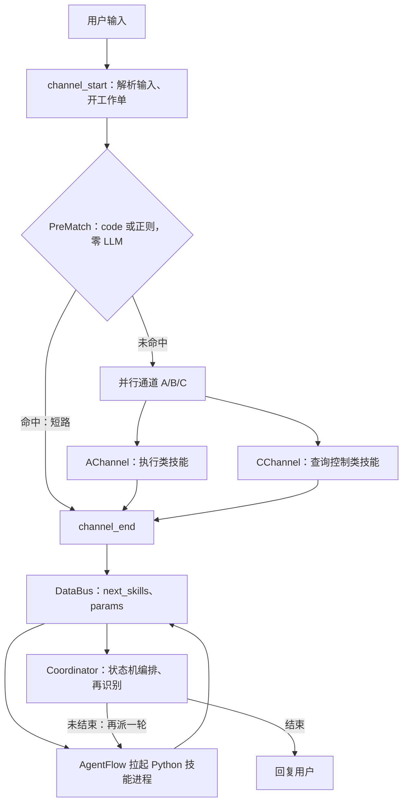
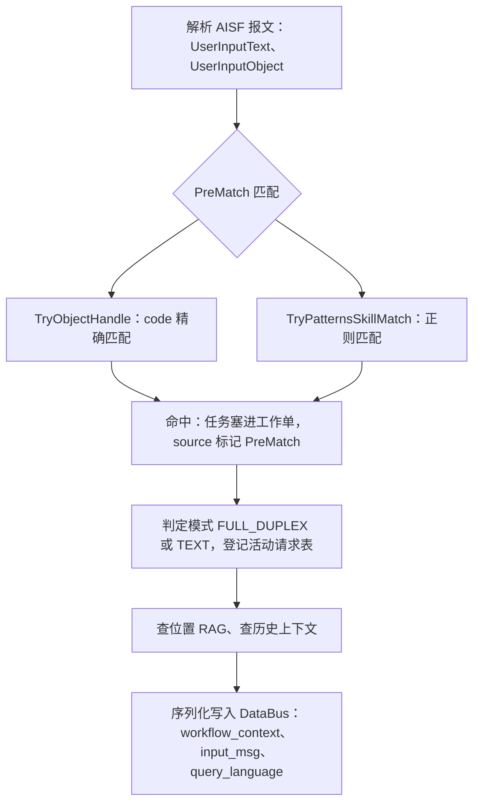
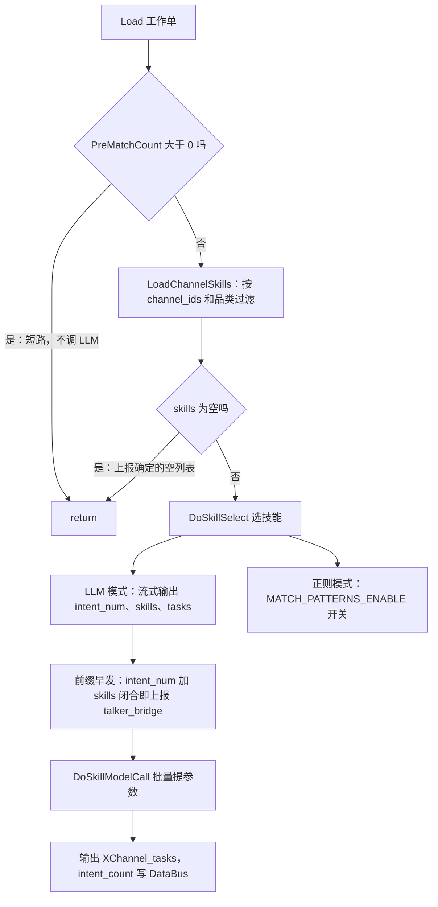
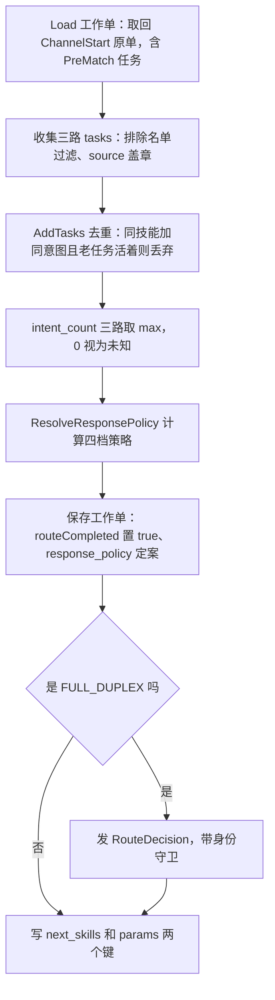
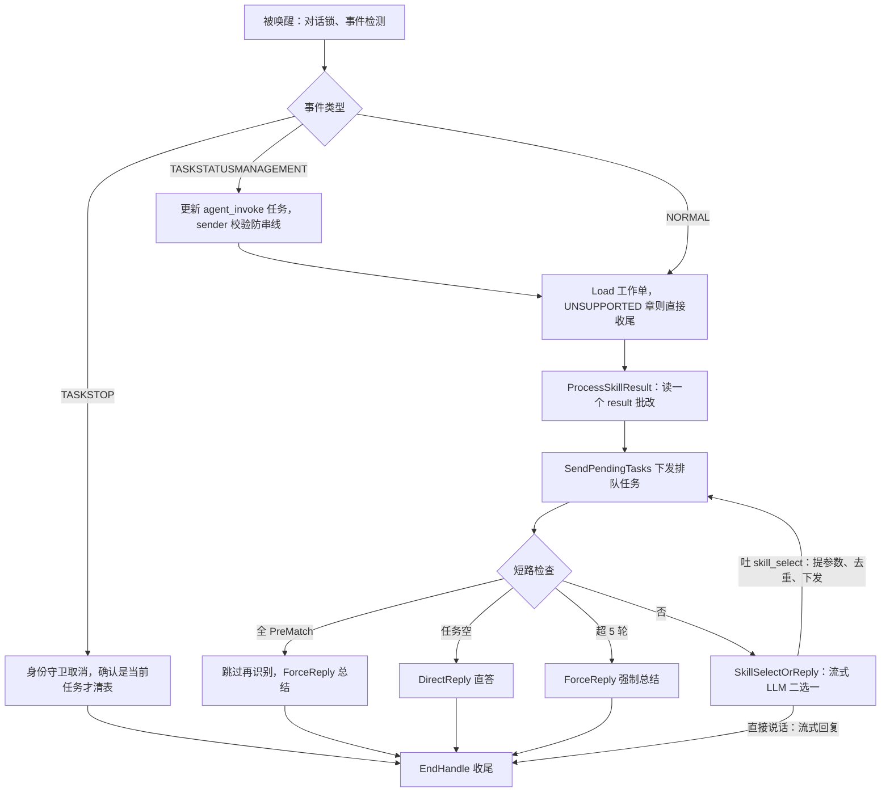
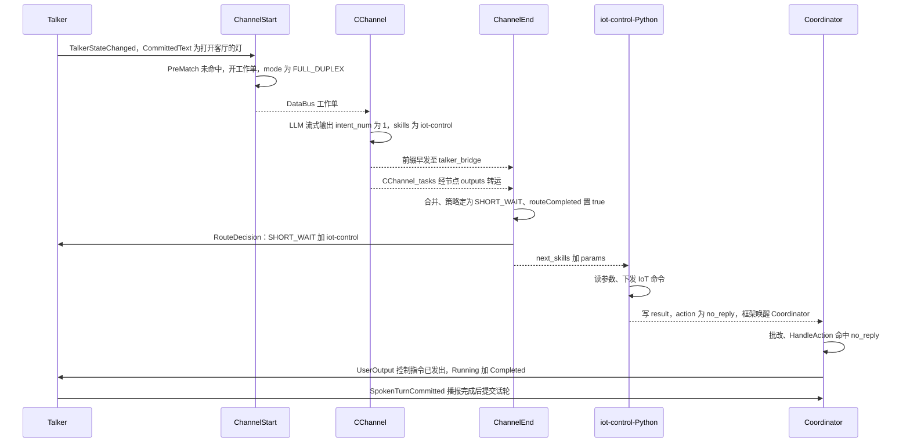

# SysAgent 路由架构图解（V4）

> 适用分支：`personal/ljw/dev-qwen3.8`（基于 `dev`）
> 依据文档：[docs/v4-intent-recognition.md](docs/v4-intent-recognition.md)、[thinker v4内部设计.md](thinker%20v4内部设计.md)、[talker-thinker接口规范.md](talker-thinker接口规范.md)
> 生成日期：2026-10-19
> 说明：本文是学习笔记，mermaid 图使用兼容旧版渲染器的保守语法（无圆筒形状、无 ` `、无形状内引号）。

---

## 一、总览：三层漏斗 + 四站流水线

**文字说明**：路由 = 派单系统，把用户一句话变成任务清单（tasks）交给执行层。三层漏斗：

| 层 | 节点 | 走 LLM 吗 | 职责 |
|----|------|-----------|------|
| L0 预匹配 | ChannelStart 里的 PreMatch | 否（code/正则） | 加速直达，命中后短路全部 LLM 路由 |
| L1 并行识别 | A/B/C Channel | 正则或 LLM | 首轮粗筛，多通道并行产出 tasks |
| L2 编排再识别 | Coordinator | LLM 流式 | 基于执行结果决定继续选技能或回复用户 |

四站流水线：**ChannelStart 开单 → Channel 选技能提参数 → ChannelEnd 合并定策略派活 → Coordinator 批作业收尾**。核心载体是工作单 `workflow_context`，全程通过 DataBus 流转。

---

## 二、第 0 站：ChannelStart + PreMatch（开单）

**文字说明**：

- PreMatch 是快捷键层，两种确定性匹配，**零 LLM 调用**：
  - `TryObjectHandle`（code 精确匹配）：上游发结构化对象带 code，技能的 `match_code` 认领。当前配置：nce-msg 认领 `200006/200007/100200/100201`，home-weather 认领 `200050`，leave-home 认领 `200051`。
  - `TryPatternsSkillMatch`（正则匹配）：用户文本对技能的 `match_patterns`。当前配置：refuse-answer 的 `.*(退出|停止).*播放.*`。
- 只有 `channel_ids` 含 `PreMatch` 的 4 个技能参与匹配，且有 deviceCategory 品类过滤。
- `PreMatchCount()` 不是存储字段，是从任务 `source` 字段现数的（派生状态）。
- 工作单在此诞生：身份字段 + PreMatch 任务 + 上下文备料，序列化成 JSON 存 DataBus 键 `{dialogue_id}/workflow_context`。
- 已知遗留行为：复合输入（如"停止播放，再查天气"）命中 PreMatch 时其余意图被丢弃，第一版明确不修（设计文档 §6.3）。

---

## 三、第 1 站：A/B/C Channel（选技能 + 提参数）

**文字说明**：

- 三个通道结构完全相同（共用 Channel.cpp 基类），差异只在 SKILL.md 的 `channel_ids` 注册表：

| 通道 | 定位 | 注册技能 |
|------|------|---------|
| AChannel | 操控/执行类 | fallback-a、film-tv、general-query、health-query、home-habits-query、liantong-query |
| BChannel | 预留 | 无 |
| CChannel | 查询/控制类 | fallback-c、gui-control、iot-control |

- 选技能双模式：环境变量 `MATCH_PATTERNS_ENABLE=true` 走正则（零 LLM），否则走 LLM（默认）。LLM 输出格式固定顺序 `intent_num → skills → tasks`。
- **前缀早发**：流式过程中前两个字段闭合就上报 talker_bridge，两路（A/C）前缀到齐后合并（intent_num 取 max、skills 按 A→C 顺序去重并集）早发 RouteDecision，不等 tasks 生成完。空通道上报"确定的空列表"防止另一路永久等待。
- **intent_count**：模型统计的是"整轮目标数"（非本通道认领数），即使没选中任务也上报（供 ChannelEnd 取 max）。
- 提参数三分类：`waitFor` 非空 → 保持 skip 挂起；`hasParams=true` → 任务**预设 failed**，批量一次 LLM 提参数、按 tool_call_id 回填成功才翻 pending；`hasParams=false` → 参数直接用 intent。
- 输出契约：通道只输出 `{通道名}_tasks` 数组（节点 outputs），不写工作单；task_id 在 BuildTask 时生成（`{技能名}_{8位uuid}`）。

---

## 四、第 2 站：ChannelEnd（合并 + 定策略 + 派活）

**文字说明**：

- ChannelEnd 是"融合者"，三种原材料融合成新单：DataBus 原单（PreMatch 任务）+ 节点 inputs 三路任务 + DataBus 三路意图数。
- 排除名单（ChannelExcludedSkills）：A 通道排除 fallback-a、C 通道排除 fallback-c，早发过滤与最终过滤共用同一份名单，防止口径漂移。
- 去重规则（AddTasks）：同技能 + 同意图 + 老任务状态为 done/running/pending（或状态相同）→ 丢弃；**失败的任务不挡道，允许重试**。
- intent_count 合并：**取最大值不相加**（三通道数的是同一件事），0 = 未知（正则/失败/空通道），max 方向永远朝保守侧。
- ResponsePolicy 由代码判定（ChannelRoutePolicy.h），判定顺序固定：
  1. 显式不支持且不再回复 → UNSUPPORTED（拒答，Thinker 零输出）
  2. 技能列表空 → DIRECT_RESPONSE（Thinker 直答）
  3. intentCount ≠ 1 → LONG_WAIT（含 0=未知，保守）
  4. 技能全在白名单（home-habits-query/general-query/liantong-query/iot-control）→ SHORT_WAIT，否则 LONG_WAIT
- `routeCompleted = true` 是路由收官的盖章（触发 ROUTING→PENDING 计时桩）。
- 发 RouteDecision 前过**身份守卫**：本节点 requestId 必须等于活动请求表的 currentRequestId，防旧 workflow 重跑发出幽灵 RouteDecision。早发过的策略沿用（对账只告警、不撤回）。
- 先发决策再派活：保证 Talker 收包顺序 RouteDecision → OutputStarted → UserOutput。
- `SendPendingTasks` 写三键协议的两条上行键：`sys/{dialogue_id}/next_skills`（任务清单）+ `user/{dialogue_id}/{task_id}_params`（参数），控制权移交 Python 世界。

---

## 五、第 3 站：Coordinator（状态机 + 编排）

**文字说明**：

- Coordinator 是"失忆患者读日记"：每次唤醒都是全新执行实例，靠 Load 工作单恢复记忆；干一步、退出、等事件、再被唤醒。
- 每次唤醒先做三件事：拿对话锁（每 dialogueId 一把，try_lock 快速路径）、检测事件类型、Load 工作单。
- 三类事件：
  - TASKSTOP（用户取消）：身份守卫确认取消的是当前任务才清活动请求表（防迟到的旧取消误杀新请求），然后收尾。
  - TASKSTATUSMANAGEMENT（下游 Agent 回话）：只认 TaskCompleted，校验 sender 防串线，更新挂起的 agent_invoke 任务后继续主循环。
  - NORMAL：正常推进（技能结果到达、首次下发等）。
- ProcessSkillResult **一次只批一本作业**：读 `{task_id}_result` 键 → UpdateTaskResult 更新状态 → HandleAction 按 action 分流 → Save → 删除 result 键（防重复消费）。保证流式语义、结果及时消费、随时可被取消打断。
- 六条终结型短路（绕开再识别循环）：
  1. TASKSTOP 取消 → 收尾（零 LLM）
  2. UNSUPPORTED 章 → 静默收尾（零 LLM，Talker 拒答）
  3. 全 PreMatch → 跳过再识别，需要回复则 ForceReply 总结
  4. 任务空 → DirectReply 直答（对应 DIRECT_RESPONSE 承诺，不补选技能）
  5. 超 5 轮 → ForceReply 强制总结（防死循环）
  6. 新选技能全被去重（added==0）→ ForceReply
- **SkillSelectOrReply**（唯一正常路径）：一次流式 LLM 二选一——吐 `<skill_select>` 标签 = 再派一轮（清空 waitFor、去重后下发）；直接说话 = 边收边流式回复用户。
- 5 轮上限 + AddTasks 去重是防死循环双保险：横向防重复劳动、纵向防无限新活。
- EndHandle 收尾：补 Completed 帧、计时汇总（routing_ms/pending_ms/running_ms）、清理工作单。

---

## 六、全链路时序（例子：打开客厅的灯）

**文字说明**：注意两条数据通道的分工——工作单走 DataBus（公告板），通道任务走节点 outputs（框架点对点转运）；前缀早发和最终 RouteDecision 各一次（幂等）；技能写 result 后由框架唤醒 Coordinator，形成状态机闭环。

---

## 七、关键概念速查表

| 概念 | 一句话 |
|------|--------|
| workflow_context | 一次请求的共享工作单，序列化存 DataBus，各节点 Load→改→Save |
| PreMatch | 零 LLM 的规则快速通道（code + 正则），命中即短路 |
| intent_num | 模型统计的整轮目标数，三路取 max 后唯一作用是判等待档位 |
| ResponsePolicy | 代码判定四档：UNSUPPORTED / DIRECT_RESPONSE / SHORT_WAIT / LONG_WAIT |
| 三键协议 | next_skills 派活 / {task_id}_params 参数 / {task_id}_result 结果 |
| 身份守卫 | 动手前查活动请求表确认"我还是当前请求吗"，防幽灵消息 |
| task_id | {技能名}_{8位uuid}，贯穿三键的快递单号 |
| 防呆默认 | 任务预设 failed、提参成功才翻 pending、失败没有沉默权 |
| 计时打桩 | 请求级状态投影 NONE→ROUTING→PENDING→RUNNING→DONE/FAILED，落 trace JSONL |

---

## 附：文档过时点备忘（以当前代码为准）

| 文档说法 | 当前代码事实 |
|---------|-------------|
| ObjectHandleChannel 是第 4 个并行通道 | 已并入 ChannelStart 的 PreMatch，ChannelEnd 只收三路 |
| Channel 层 LLM 输出 `<skill_select>` XML 标签 | 新格式为 `{intent_num, skills, tasks}` 固定顺序 JSON（解析器兼容两种） |
| task_id 由 ChannelEnd 统一生成 | 实际在 BuildTask（Channel 阶段）生成 |
| 全 PreMatch 时连总结 LLM 也跳过 | 当前代码按 NeedReply 保留 ForceReply 总结（两次 bug 修复演进而来） |
| 文档源码索引的行号 | 普遍漂移，以代码为准 |
