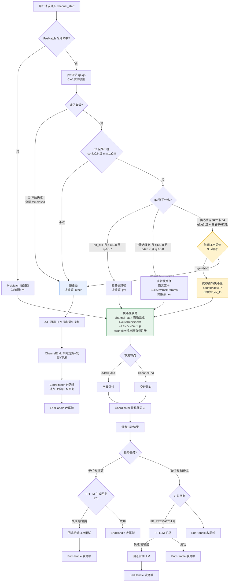

# 当前集中路由情况示意图（ttseparation 全开版）

## 图例说明

- 🟨 **黄色块 = 提参扩覆盖**（本方案新增的救援路径，决策源 `jev_fp`）
- 🟩 **绿色块 = 快路径收尾**（channel_start 当场发帧+PENDING+下发，ChannelEnd/A/C 空转跳过）
- 🟦 **蓝色块 = 慢路径**（jev 判 none / 评估失败 / 提参失败的回退，现状老管线，决策源 `other`）

## 当前全量 100 条流量分布（排除 film-tv 93 轮）

| 路径 | 轮数 | 准确率 |
|---|---|---|
| jev 直转（decision_source=jev） | 38 | 97.4% |
| 提参直转（jev_fp，成功 13/尝试 19） | 13 | 100.0% |
| jev 直答（direct_reply） | 0 | — |
| 慢路径（other，含 13 轮 jev 评估失败） | 42 | 76.2% |

- 提参触发 19 轮：成功 13（耗时 p50=8.3s、p90=20.3s、max=24.8s）、失败 6（全部 call_failed）
- jev 评估失败 13 轮：q1-q5 全零 + q3 空 + decision=none，fail-closed 回退 LLM（Clef 响应解析异常，耗时统一 ~5.4s，待排查）
