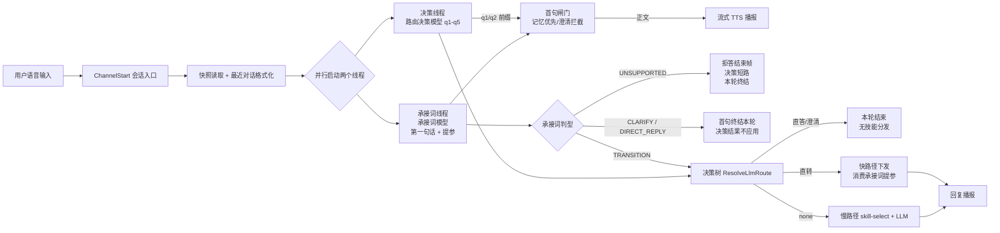
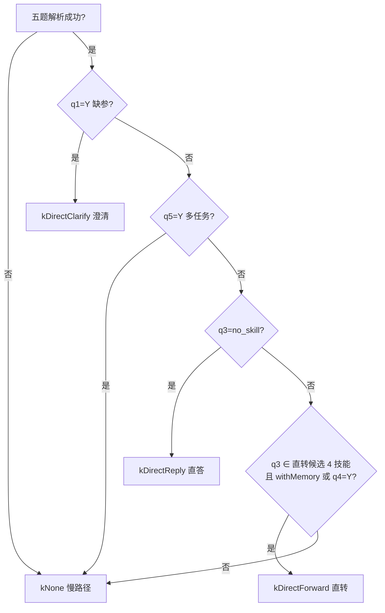
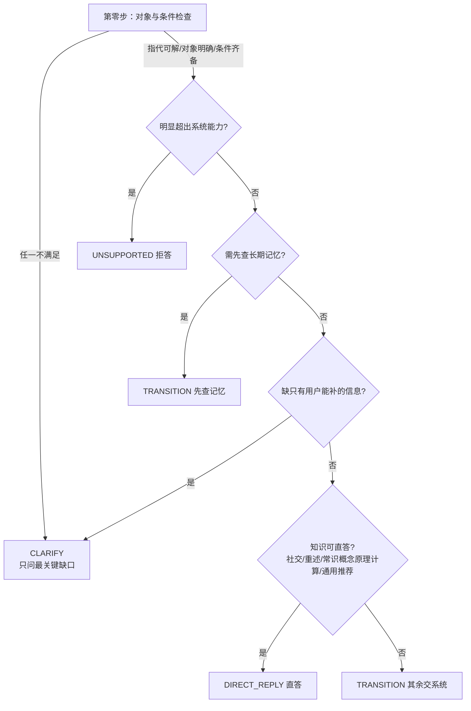
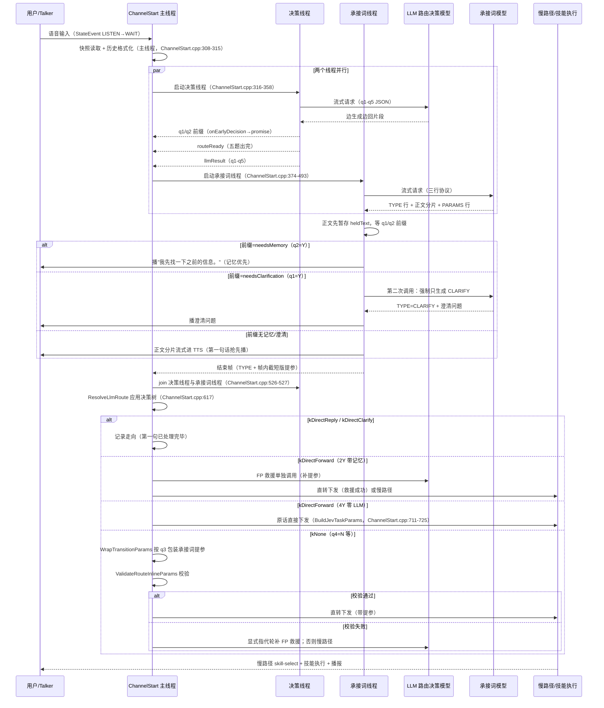

# 承接词模型与 LLM 路由决策模型协作流程讲解

> 适用版本：E12（2026-11-22 上线）。所有流程描述均有代码依据，引用格式为 `文件:行号`，行号对应分支 `personal/ljw/dev-qwen3-jev-llm-ttseparation` 提交 `05be0a7`。

---

## 1. 一图总览：端到端流程



一句话概括：**两个模型并行工作**——路由决策模型回答五道题决定"走哪条路"，承接词模型负责"说出口的第一句话"并在 TRANSITION 时顺带产出提参；用户听到的第一句话在路由决策完成之前就已经开始播。

**承接词判型反过来决定决策结果用不用**（图中 `KT` 节点）：

| 承接词判型 | 对决策的影响 | 依据 |
|---|---|---|
| UNSUPPORTED | 发拒答结束帧，决策线程 detach、不产生下游输入——五题结果完全作废 | `ChannelStart.cpp:406-412,559-566` |
| CLARIFY / DIRECT_REPLY | 首句即终结本轮（`preRouteTerminal`），跳过 4b 路由应用 | `ChannelStart.cpp:483,559-566` |
| TRANSITION | 唯一消费决策结果的类型：join 决策线程 → 4b 应用决策树 → 直转/慢路径 | `ChannelStart.cpp:573-576,611+` |
| 例外：显式指代轮判了 DIRECT_REPLY | 被路由 q3 结果反向覆盖为 TRANSITION（"我先确认一下。"），继续走路由 | `ChannelStart.cpp:420-424` |

（4b 里的 kDirectReply/kDirectClarify 分支只在"首句已 TRANSITION、路由却判 no_skill/q1=Y"的错位场景被走到，属兜底记录。）

---

## 2. 角色定位：各司其职

| | LLM 路由决策模型 | 承接词模型 |
|---|---|---|
| 职责 | **判定 + 选技能**：这轮该不该澄清、要不要查记忆、是单任务还是多任务、选哪个技能、能不能原样直转 | **对用户说出口的话**：第一句话（承接语/直接回答/澄清问题）+ TRANSITION 时**顺带提参** |
| 输出 | 五行 JSON：`{"q1","q2","q5","q3","q4"}` | 三行文本：`TYPE=类型` / 可朗读正文 / `PARAMS=提参` |
| 速度策略 | 流式输出，q1/q2 一出先上报"前缀" | 正文流式进 TTS，抢首字时延 |
| 消费方 | 应用层决策树 + 技能分发 | TTS 播报 + 直转提参链路 |

**为什么拆成两个模型**：

1. **首字时延**：第一句话不等路由决策完成（两模型并行，`ChannelStart.cpp:316-358` 与 `374-493`）；
2. **职责可替换**：E12 把提参职责从路由决策模型移交到承接词模型——未来路由决策可换成只会"选择/排序/打分"的 JEV 模型，提参能力不受影响（这是 E12 的核心动机）；
3. **口径分离**：说出口的话有"16 字以内、句首先应一声"等口语约束，路由判定有"精确标识、四类缺参"等业务约束，两个 prompt 各自演化互不干扰。

---

## 3. LLM 路由决策模型内部

### 3.1 输入与输出

- **代码**：`agents/system_agent_v4/utils/route_llm/RouteLlmAssessor.cpp`、`RouteLlmPolicy.h`
- **输入**：本轮原话 + 最近对话（`BuildJevState`：历史段限 2000 字符、当前问题永不截断，`JevAssessor.cpp:59-84`）+ 候选技能清单（no_skill + 4 业务技能 + other；general-query 特化"仅支持天气查询"，`RouteLlmAssessor.cpp:101-110`）
- **输出**：固定字段顺序 JSON，E12 起只输出五个字段、不再带提参（`RouteLlmAssessor.cpp:118-122`）：

```json
{"q1":"Y或N","q2":"Y或N","q5":"Y或N","q3":"技能名或no_skill或other","q4":"Y或N"}
```

### 3.2 五道题（`RouteLlmAssessor.cpp:55-117`）

| 题 | 问什么 | 用途 |
|---|---|---|
| q1 | 是否有只能向用户追问的必要信息？（四类缺参自查：精确标识不完整 / 操作对象没名称 / 查数值没给所属对象 / 上轮只承诺没给结果） | 缺参 → 澄清 |
| q2 | 是否必须召回助手长期记忆里的个人事实？ | 记忆 → 先召回 |
| q5 | 本轮任务数量是否大于 1？ | 多任务 → 不直转 |
| q3 | 当前目标应由哪个候选技能处理？ | 选技能（或 no_skill/other） |
| q4 | 只读当前原话，执行方看不到历史/记忆，能否原样下发？（默认 N，"一律 N"五条：句内指代未消解 / 依赖上轮条件 / 有错字乱序口头禅 / 需补动作参数 / q3=no_skill） | 可原样 → 零 LLM 直转 |

### 3.3 流式 + 前缀机制（`RouteLlmAssessor.cpp:199-236`）

模型边生成边把 JSON 片段回调出来；`ParseRouteDecisionPrefix` 一解析出 q1、q2，立即经 `onEarlyDecision` → `promise` 通知承接词线程（`ChannelStart.cpp:323-337`）——**不用等五题全出完**。端点不支持 SSE 时在同一超时预算内回退整包调用（`RouteLlmAssessor.cpp:229-232`）。

### 3.4 决策树（`RouteLlmPolicy.h:67-90`）



直转候选集（快路径 4 技能）：iot-control / film-tv / general-query / liantong-query（`JevRoutePolicy.h` `IsJevForwardableSkill`）。gui-control / health-query / home-habits-query 无快路径、走慢路径。

---

## 4. 承接词模型内部

### 4.1 输入与输出

- **代码**：`agents/system_agent_v4/utils/transition/TransitionAssessor.cpp`
- **输入**：本轮原话 + 最近对话 + 一行"系统能力"概览（E12 起技能列表删除，`TransitionAssessor.cpp:121-148`）
- **输出**：三行协议（E12），TRANSITION 轮**无条件必出** PARAMS：

```
TYPE=TRANSITION
好的，帮你查话费
PARAMS=给130****8888充50元话费
```

### 4.2 判型逻辑（prompt，`TransitionAssessor.cpp:14-100`）



- 第零步闸门含设备对象锚点：仅说房间名、未指明设备或模式（如"切换到卧室"）不算明确（`TransitionAssessor.cpp:24`）；
- 承接正文约束：16 字以内、句首先应一声（好/好的/收到…轮换）、不暗示结果、不承诺时长；
- PARAMS 约束：补全后的最短可执行文本、原话完整则原样、多操作分号分隔。

### 4.3 流式解析（`TransitionStream`，`TransitionAssessor.cpp:150-260`）

- TYPE 行不进 TTS；正文行首最多暂存 7 字节排除 `PARAMS=` 标记、其余字节随到随流；PARAMS 行剥离不进 TTS；
- **半字符绝不单独成帧**：多字节字符必须合并流出（2026-11-22 的 1007 断连事故教训——半个字符进帧会触发客户端协议断连整轮）。

---

## 5. 两模型配合

### 5.1 配合点小结

| 配合点 | 谁触发 | 谁响应 | 效果 |
|---|---|---|---|
| q1/q2 前缀闸门 | 决策模型流式输出 | 承接词线程 `routePrefix.wait_for`（`ChannelStart.cpp:391-401`） | 首句不被缺参/记忆轮污染 |
| 记忆优先 | 决策 q2=Y | 承接词线程换固定播报"我先找一下之前的信息。"（`ChannelStart.cpp:426-435`） | 先召回再答复 |
| 强制澄清 | 决策 q1=Y/q2=N | 承接词模型**第二次调用**（带路由约束，只生成 CLARIFY，`ChannelStart.cpp:436-466`） | 澄清问题口径一致 |
| 提参移交（E12） | 承接词 PARAMS 行 | kNone 分支按 q3 包装（`ChannelStart.cpp:727-737`） | 路由模型不再输出提参，为 JEV 替换铺路 |
| 帧内提参 | 承接词模型 | PreRouteOutput 结束帧 Params 字段（截 64 字节） | 测试观测；完整版走 trace |

### 5.2 完整时序



**关键时序事实**：

1. 两模型共享同一份话轮快照、并行开工（`ChannelStart.cpp:310-314`）；
2. 承接词正文先攒 `heldText`，等 q1/q2 前缀决定播不播（`ChannelStart.cpp:391-401`）；
3. 强制澄清是承接词模型的第二次调用，并发生成的正文作废（`ChannelStart.cpp:436-466`）；
4. 路由和提参只能在承接词模型表态后应用；发送正文和结束帧不等待 join（`ChannelStart.cpp:526-527`）；
5. 提参消费点只在 kNone 分支：`WrapTransitionParams(choice, transitionResult.params)`（iot-control→分号切分逐条编号 command，其余→intent）→ `ValidateRouteInlineParams` 校验（schema/防复读/指代残留）→ 通过直转、失败慢路径/救援（`ChannelStart.cpp:727-777`）。

---

## 6. 当前效果数据（2026-11-22 部署实测，200 条人工标注同口径）

### 6.1 承接词模型四类型准确率

| 口径 | 准确率 | 说明 |
|---|---|---|
| 部署内网 32B（当前） | **154/200 = 77.0%** | E5 基线 79.0%（-2.0pp，已接受） |
| 离线 OpenRouter 32B t=0 | 86.5% | 与 E5 离线持平；内网"爱追问"画像差 ~9.5pp |

错误画像（部署端）：漏澄清 17（该澄清却承接）/ 过度澄清 17（该承接却澄清）/ 漏直答 8 / 抢答 4。提参存在率 **95.4%**（130 个 TRANSITION 轮里 124 轮输出了 PARAMS）。

### 6.2 承接词 MOS 分（judge_MOS，200 行全计分）

| 指标 | 值 |
|---|---|
| 触发分均值 | 21.75 / 30 |
| 内容分（七维 0-100） | 94.38（110 行有承接语） |
| 总分均值 | 58.09 / 100 |
| 等级分布 | 优秀 101 / 合格 8 / 正确不承接 35 / 不合格 56 |
| 四类触发分布 | 需要承接 110 / 漏触发 35（率 24.1%）/ 误触发 20（率 36.4%）/ 正确不承接 35 |

结论：**接对了的时候内容质量很高（七维 94.4），总分被"该不该接"的判定层拖下来**（55 行触发 0 分）。

### 6.3 LLM 路由决策模型五题准确率（judge_jev，分母 130）

| 题 | 正确率 |
|---|---|
| q1 意图清晰 | 83.8% |
| q2 上下文充分 | 93.8% |
| q3 技能选择 | 86.9% |
| q4 可原样直转 | **100%** |
| q5 单任务 | 98.5% |
| **综合（阶梯口径）** | **85.4%**（T 111 / F 19） |

综合口径（`judge_jev.py` step_verdict）：按裁判答案分三层——①裁判认为要澄清/查记忆时只比 q1+q2；②否则多任务时只比 q5；③否则只比 q3+q4。逐题独立口径下 q1 最弱（83.8%）；完整决策树复现的"决策一致率"为 65.4%（更严，任何一题分歧都可能翻决策）。

---

## 7. 边界与兜底

每个异常都有确定的降级路径，不存在"模型挂了整轮就卡死"：

| 边界 | 兜底行为 | 依据 |
|---|---|---|
| 路由模型配置非法 / 调用失败 / 超时 | `valid=false` → 决策树返回 kNone → 慢路径（skill-select 自己选技能执行） | `RouteLlmAssessor.cpp:207-209,236-238`；`RouteLlmPolicy.h:67-71` |
| 路由端点不支持 SSE | 同一超时预算内回退整包调用；已有输出时不重复请求 | `RouteLlmAssessor.cpp:229-232` |
| 路由 JSON 解析失败 | fail-closed 全部字段不写 out → kNone 慢路径 | `RouteLlmAssessor.cpp:141-166` |
| 承接词模型失败 / 超时 / 输出无有效类型 | 无正文外发（`textSent=false`）、不发结束帧，本轮**照常走路由应用**（直转提参为空 → 校验失败 → 慢路径） | `ChannelStart.cpp:477`；`ChannelStart.cpp:727-737` |
| 承接词判 UNSUPPORTED | 提前终态：直接发拒答结束帧，跳过路由应用 | `ChannelStart.cpp:406-412` |
| q1=Y 强制澄清但重生成失败 | 固定兜底问句"你能再补充一下具体需求吗？" | `ChannelStart.cpp:453-458` |
| 显式指代轮模型误判直答 | 强制改为 TRANSITION（"我先确认一下。"），等路由结果再定 | `ChannelStart.cpp:420-424,468-470` |
| 提参校验失败（schema/复读/指代残留） | 显式指代轮补一次 FP 救援 LLM；仍失败或非指代轮 → 慢路径 | `ChannelStart.cpp:738-753` |
| 2Y 带记忆轮救援失败 | 降级 direct_clarify 或慢路径 | `ChannelStart.cpp:698-710` |
| 正文已交付后流失败 | 发 FAILED 帧、终止本轮，禁止回退任务分发 | `ChannelStart.cpp:485-492` |
| 帧内提参过长 | 帧内截 64 字节（UTF-8 安全），完整提参走 trace 观测，服务端直转仍用全文 | `TransitionAssessor.cpp` `TruncateUtf8` |
| 模型输出含非法 UTF-8 | 提参出流前清洗；正文流式分片保证字符对齐（1007 断连事故修复） | `TransitionAssessor.cpp` `SanitizeUtf8`/`EndsWithPartialUtf8` |

一句话：**所有模型失败最终都收敛到"慢路径"或"澄清"两条安全线上**，快路径只是"加分项"——它崩了不会把轮次带走。
