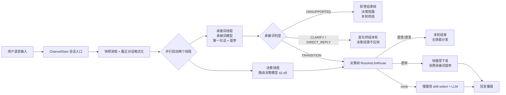
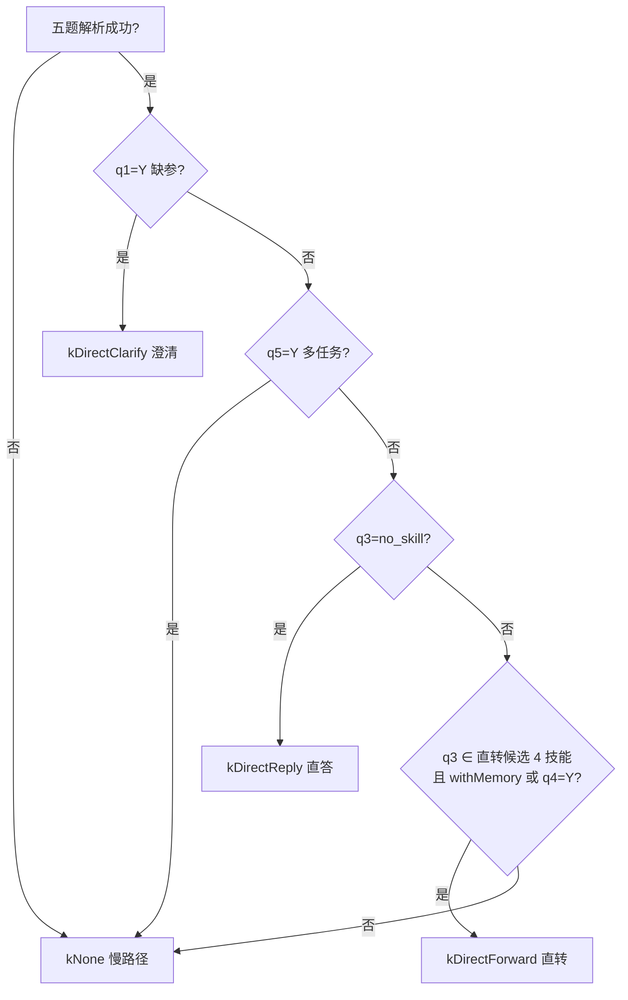
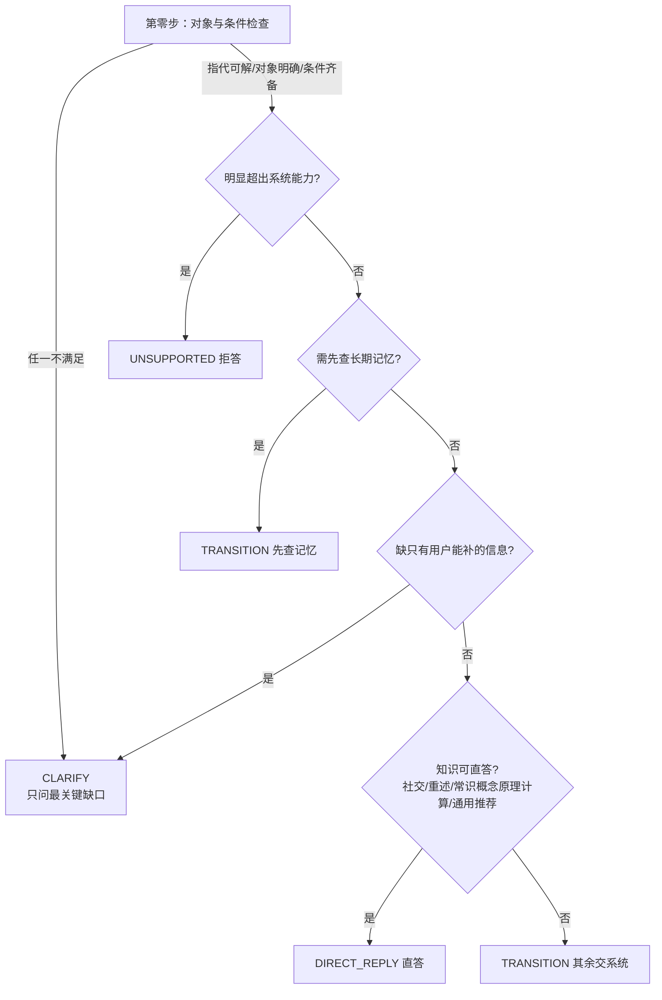

# 承接词模型与 LLM 路由决策模型协作流程讲解

> 适用版本：E12（2026-11-22 上线）。所有流程描述均有代码依据，引用格式为 `文件:行号`，行号对应分支 `personal/ljw/dev-qwen3-jev-llm-ttseparation` 提交 `05be0a7`。

---

## 1. 一图总览：端到端流程



一句话概括：**两个模型并行工作**——路由决策模型回答五道题决定"走哪条路"，承接词模型负责"说出口的第一句话"并在 TRANSITION 时顺带产出提参；用户听到的第一句话在路由决策完成之前就已经开始播。

**承接词判型反过来决定决策结果用不用**（图中 `KT` 节点）：

| 承接词判型 | 对决策的影响 | 依据 |
|---|---|---|
| UNSUPPORTED | 发拒答结束帧，决策线程 detach、不产生下游输入——五题结果完全作废 | `ChannelStart.cpp:406-412,559-566` |
| CLARIFY / DIRECT_REPLY | 首句即终结本轮（`preRouteTerminal`），跳过 4b 路由应用 | `ChannelStart.cpp:483,559-566` |
| TRANSITION | 唯一消费决策结果的类型：join 决策线程 → 4b 应用决策树 → 直转/慢路径 | `ChannelStart.cpp:573-576,611+` |


---

## 2. 角色定位：各司其职

| | LLM 路由决策模型 | 承接词模型 |
|---|---|---|
| 职责 | **判定 + 选技能**：这轮该不该澄清、要不要查记忆、是单任务还是多任务、选哪个技能、能不能原样直转 | **对用户说出口的话**：第一句话（承接语/直接回答/澄清问题）+ TRANSITION 时**顺带提参** |
| 输出 | 五行 JSON：`{"q1","q2","q5","q3","q4"}` | 三行文本：`TYPE=类型` / 可朗读正文 / `PARAMS=提参` |
| 消费方 | 应用层决策树 + 技能分发 | TTS 播报 + 直转提参链路 |

**为什么拆成两个模型**：

1. **首字时延**：第一句话不等路由决策完成（两模型并行，`ChannelStart.cpp:316-358` 与 `374-493`）；
2. **职责可替换**：E12 把提参职责从路由决策模型移交到承接词模型——未来路由决策可换成只会"选择/排序/打分"的 JEV 模型，提参能力不受影响（这是 E12 的核心动机）；
3. **口径分离**：说出口的话有"16 字以内、句首先应一声"等口语约束，路由判定有"精确标识、四类缺参"等业务约束，两个 prompt 各自演化互不干扰。

---

## 3. LLM 路由决策模型内部

### 3.1 输入与输出

- **代码**：`agents/system_agent_v4/utils/route_llm/RouteLlmAssessor.cpp`、`RouteLlmPolicy.h`
- **输入**：本轮原话 + 最近对话（`BuildJevState`：历史段限 2000 字符、当前问题永不截断，`JevAssessor.cpp:59-84`）+ 候选技能清单（no_skill + 4 业务技能 + other；general-query 特化"仅支持天气查询"，`RouteLlmAssessor.cpp:101-110`）
- **输出**：固定字段顺序 JSON，E12 起只输出五个字段、不再带提参（`RouteLlmAssessor.cpp:118-122`）：

```json
{"q1":"Y或N","q2":"Y或N","q5":"Y或N","q3":"技能名或no_skill或other","q4":"Y或N"}
```

### 3.2 五道题（`RouteLlmAssessor.cpp:55-117`）

| 题 | 问什么 | 用途 |
|---|---|---|
| q1 | 是否有只能向用户追问的必要信息？（四类缺参自查：精确标识不完整 / 操作对象没名称 / 查数值没给所属对象 / 上轮只承诺没给结果） | 缺参 → 澄清 |
| q2 | 是否必须召回助手长期记忆里的个人事实？ | 记忆 → 先召回 |
| q5 | 本轮任务数量是否大于 1？ | 多任务 → 不直转 |
| q3 | 当前目标应由哪个候选技能处理？ | 选技能（或 no_skill/other） |
| q4 | 只读当前原话，执行方看不到历史/记忆，能否原样下发？（默认 N，"一律 N"五条：句内指代未消解 / 依赖上轮条件 / 有错字乱序口头禅 / 需补动作参数 / q3=no_skill） | 可原样 → 零 LLM 直转 |


### 3.3 决策树（`RouteLlmPolicy.h:67-90`）



直转候选集（快路径 4 技能）：iot-control / film-tv / general-query / liantong-query（`JevRoutePolicy.h` `IsJevForwardableSkill`）。gui-control / health-query / home-habits-query 无快路径、走慢路径。

---

## 4. 承接词模型内部

### 4.1 输入与输出

- **代码**：`agents/system_agent_v4/utils/transition/TransitionAssessor.cpp`
- **输入**：本轮原话 + 最近对话 + 一行"系统能力"概览（E12 起技能列表删除，`TransitionAssessor.cpp:121-148`）
- **输出**：三行协议（E12），TRANSITION 轮**无条件必出** PARAMS：

```
TYPE=TRANSITION
好的，帮你查话费
PARAMS=给130****8888充50元话费
```

### 4.2 判型逻辑（prompt，`TransitionAssessor.cpp:14-100`）



- 第零步闸门含设备对象锚点：仅说房间名、未指明设备或模式（如"切换到卧室"）不算明确（`TransitionAssessor.cpp:24`）；
- 承接正文约束：16 字以内、句首先应一声（好/好的/收到…轮换）、不暗示结果、不承诺时长；
- PARAMS 约束：补全后的最短可执行文本、原话完整则原样、多操作分号分隔。

### 4.3 流式解析（`TransitionStream`，`TransitionAssessor.cpp:150-260`）

- TYPE 行不进 TTS；正文行首最多暂存 7 字节排除 `PARAMS=` 标记、其余字节随到随流；PARAMS 行剥离不进 TTS；
- **半字符绝不单独成帧**：多字节字符必须合并流出（2026-11-22 的 1007 断连事故教训——半个字符进帧会触发客户端协议断连整轮）。

---

## 5. 当前效果数据（2026-11-22 部署实测，200 条人工标注同口径）

### 5.1 承接词模型四类型准确率

| 口径 | 准确率 |
|---|---|
| 部署内网 32B（当前） | **154/200 = 77.0%** |

错误画像（部署端）：漏澄清 17（该澄清却承接）/ 过度澄清 17（该承接却澄清）/ 漏直答 8 / 抢答 4。提参存在率 **95.4%**（130 个 TRANSITION 轮里 124 轮输出了 PARAMS）。

### 5.2 承接词 MOS 分（judge_MOS，200 行全计分）

| 指标 | 值 |
|---|---|
| 触发分均值 | 25.2 / 30 |
| 内容分（七维 0-100） | 94.38（110 行有承接语） |
| 总分均值 | 91.266 / 100 |

结论：**接对了的时候内容质量很高（七维 94.4）。

### 5.3 LLM 路由决策模型五题准确率（judge_jev，分母 130）

| 题 | 正确率 |
|---|---|
| q1 意图清晰 | 83.8% |
| q2 上下文充分 | 93.8% |
| q3 技能选择 | 86.9% |
| q4 可原样直转 | **100%** |
| q5 单任务 | 98.5% |
| **综合（阶梯口径）** | **85.4%**（T 111 / F 19） |

综合口径（`judge_jev.py` step_verdict）：按裁判答案分三层——①裁判认为要澄清/查记忆时只比 q1+q2；②否则多任务时只比 q5；③否则只比 q3+q4。逐题独立口径下 q1 最弱（83.8%）；完整决策树复现的"决策一致率"为 65.4%（更严，任何一题分歧都可能翻决策）。

---
